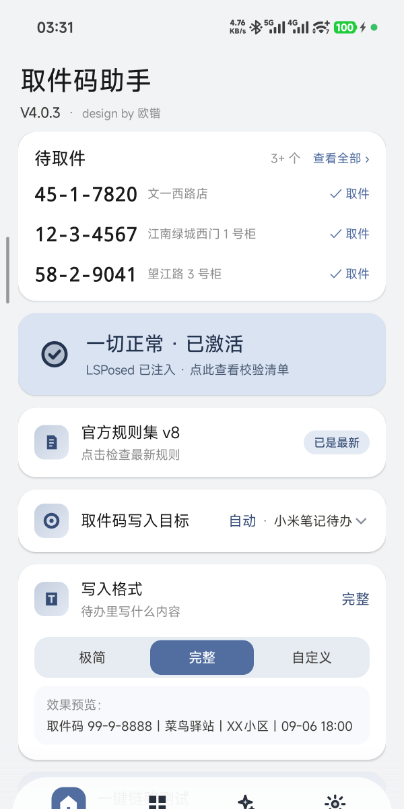
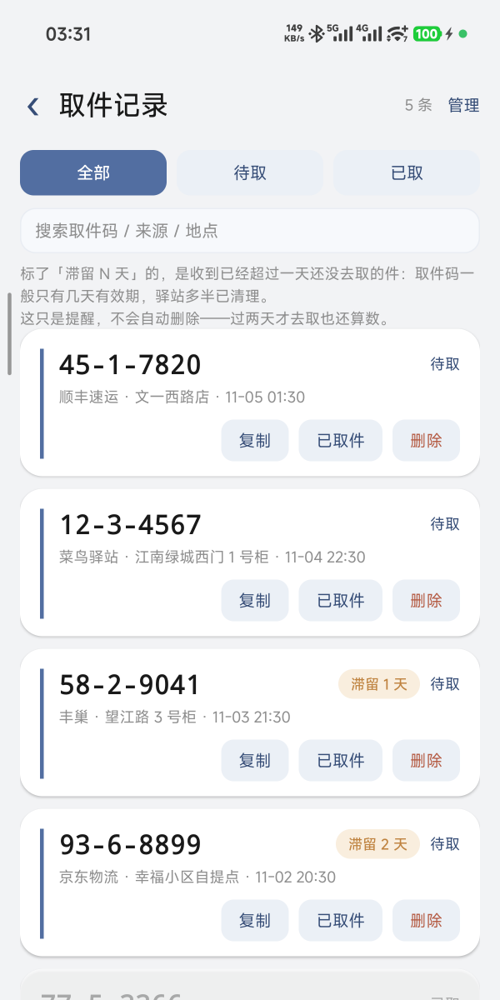
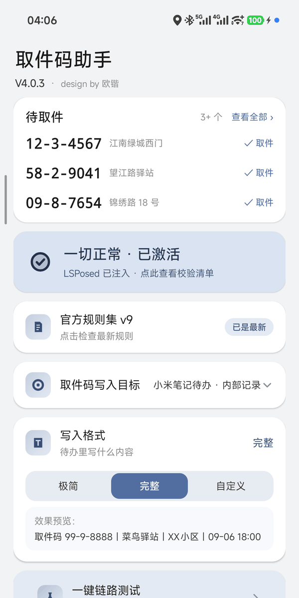
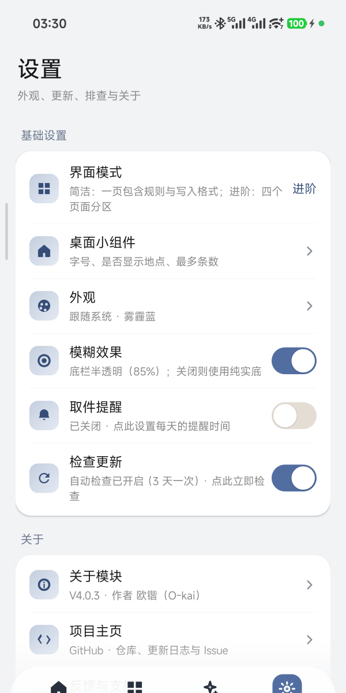
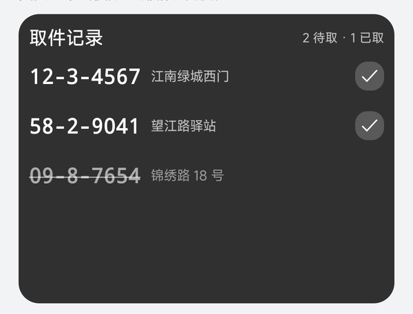

<div align="center">

# 取件码助手

**取件短信一到，取件码就躺在你手边。**

[](LICENSE)
[](https://github.com/O-kai/Xiaomi-HyperOs-pickup-code-grabber/releases)
[](#环境要求)

一个跑在 **LSPosed** 上的取件码聚合模块：从短信和 App 通知里认出取件码，
存进本地库，顺手同步到系统待办，并给桌面一个小部件。

取件码原本散在驿站短信、快递柜通知、电商 App 的推送里，格式还各不相同；
取件时翻半天，过期了才发现。这个模块把它们收拢到一处——**收到就记下，要用时一眼看到**。

</div>

<p align="center">
  
  
  
  
</p>
<p align="center">
  
</p>
<p align="center"><sub>首页 · 取件记录 · 简洁模式 · 设置 · 桌面小组件</sub></p>

<div align="center">

📱 [酷安（开发者主页）](https://coolapk.com/u/1222904) · 🧩 [LSPosed 模块仓库](https://github.com/Xposed-Modules-Repo/io.github.okaidev.pickupcode) · 💬 开发者 QQ 群 **901543676**（备注「取件码助手」）

</div>

---

## 它到底解决什么

取件短信散在驿站、快递柜、电商平台各自的通道里，格式五花八门（`12-3-4567`、`A88123`……），
翻找费劲，过期了才发现。这个模块做三件事：

1. **认出来** —— 短信，以及菜鸟 / 丰巢 / 京东 / 淘宝 / 抖音等 App 的通知，都能提取取件码；
2. **存下来** —— 落进本地库（Room），带状态、地点、时间，能搜索、能筛选、能导出；
3. **放到眼前** —— 首页一眼看到、桌面小组件常驻、需要时同步进系统待办。

> 取件信息**只存在你手机里**。整个 App 唯一联网的行为是「检查更新」，见[隐私与安全](#隐私与安全)。

---

## 环境要求

| 项目 | 要求 |
|---|---|
| 系统 | HyperOS / MIUI、ColorOS 16（一加 / OPPO / realme），或荣耀 MagicOS 7+；Android 9 及以上 |
| Root | Magisk 或 KernelSU（需要 `su`；写入系统待办依赖 root。荣耀侧给日历权限后可不 root 写入） |
| 框架 | LSPosed 或兼容实现（Vector 等） |
| 作用域 | 必勾 4 项：**系统框架**（LSPosed 2.x 叫「系统框架 / system」，旧版叫「Android 系统 / android」，两者等价，勾一个即可）、**电话**、**短信**（小米/一加是 `com.android.mms`，荣耀是 `com.hihonor.mms`）、**电话和短信存储**（`com.android.providers.telephony`）。；「小米笔记」和重复的「Android 系统」不再推荐勾选（勾着也不影响） |

> ⚠️ 作用域里的**框架那一项**（新版叫「系统框架」、旧版叫「Android 系统」）最容易被漏掉——
> 漏勾它，模块会显示已激活却什么都抓不到。勾完必须**重启手机**。

---

## 安装

1. 从 [Releases](https://github.com/O-kai/Xiaomi-HyperOs-pickup-code-grabber/releases) 下载 APK 安装；
2. 打开 **LSPosed** → 模块 → 启用「取件码助手」；
3. 进「作用域」，勾上表那 4 项（最常漏的是「系统框架」）；
4. **重启手机**；
5. 打开 App → 点开首页状态卡 → **点击体检**。全绿就装好了。

`sqlite3` 会由 App 自己部署到应用私有目录——**不需要手动推文件、不需要 Termux**。
写入目标默认按系统自动选（小米笔记 / ColorOS 日历待办 / 荣耀日历待办），也能在首页手动调整。

---

## 用起来是什么样

**首页** —— 最上面就是待取件，点码复制，点 ✓ 标记已取。
下面的状态卡点一下展开体检清单、再点收起；清单里有「点击体检」和「进入排查向导」。

**取件记录** —— 全部 / 待取 / 已取三种筛选 + 搜索。超过一天没取的标「滞留 N 天」，
超过七天写「滞留 7 天以上」——只是提醒，**绝不自动删除**。

**桌面小组件** —— 每行固定高度、一行一条，内容少时下面留白（不会把一条拉高撑满整个组件）。
外观设置里「显示取件码」是上级开关：关掉后整行收起，只显示「N 个待取 · M 个已取」；
「显示取件地点」在它下面，码不显示时这一项自动失效（保留你的选择，重新打开码就恢复）。点标题进 App。

**简洁模式** —— 首页只有待取件、规则集、写入目标与格式、链路测试，外加一个「更多选项」入口。
适合只想「看码、取件」的人：不用在四个 Tab 之间找东西。
想要更多规则、来源和外观设置，点「更多选项 → 进阶模式」随时切回来，数据完全共享。

**设置（进阶模式）** —— 界面模式、桌面小组件、外观（四套配色，图标跟着换）、
模糊效果、取件提醒、检查更新；关于里有版本、项目主页、错题本、QQ 群、酷安主页、清理与卸载。

**写入目标有两处，默认都开。**

| 目标 | 表现 |
|---|---|
| 系统待办 | 小米笔记待办；ColorOS 是日历待办与便签（两个独立的库，可同时写）；荣耀是日历「待办」（MagicOS 走 CalendarProvider，给日历权限后无需 root） |
| 软件内部记录 | 首页顶部「待取件」；桌面小组件读的也是它 |

桌面小组件不是第三个目标——它没有自己的库，只是「软件内部记录」的展示投影。
所以关掉内部记录时：App 内的记录一并清空、首页整块消失、桌面小组件也会从桌面移除；
想再看就重新打开记录，到「设置 → 桌面小组件」重新添加一次。

两处至少要留一个（关掉最后一个会被拦下）。选项只显示你手机系统上真有的那些。

---

## 它是怎么工作的

```
短信 ──┐
       ├─► LSPosed Hook（system_server / 电话进程）
通知 ──┘        │  提取取件码
                ▼
        Provider（唯一的跨进程入口）
                │
                ▼
        本地库 Room（事实源）──► 首页 / 记录页 / 桌面小组件
                │
                └─► root 直写系统待办（可关）
```

几个刻意的设计：

- **只留 Provider 一个跨进程入口。** 早期用导出的广播，任何 App 都能伪造一条取件短信；
  那个入口已经删掉了。
- **root 只调一次。** 用常驻的 `su -M -c sh` 通道，之后所有写入走它的 stdin——
  Magisk 的授权弹窗不会每抓一条就响一次，**打开 App 本身完全不碰 su**。
- **sqlite3 装在应用私有目录**，卸载时随应用数据一起删除，不会在系统里留 1.5MB 的二进制。

---

## 常见问题

**收到了短信，但首页没反应**
点状态卡 → 点击体检。多数是作用域漏了「Android 系统」，或者装完没重启。

**通知抓不到**
「通知提取」页确认开关开着、对应 App 在白名单里。菜鸟、菜鸟裹裹、京东、淘宝、拼多多、
顺丰、丰巢、抖音默认都在；不在列表里的 App 可以从已安装应用里自己加。

**提示写入失败**
写入系统待办需要 root。看体检里「root 授权」「待办库访问」两项的说明；
也可以在首页把「系统待办」关掉，只用软件内部记录（取件码照常显示，只是不写进笔记/日历）。

**桌面小组件显示错乱**
长按移除后重新添加一次。桌面不会重建已存在组件的视图树，布局结构变过就得重加。
设置 → 桌面小组件 →「小组件自检」可以先确认组件本身有没有问题。

**升级后要不要重启？**
要。抓取逻辑跑在系统进程里，LSPosed 只在进程启动时注入——App 在升级后会提示一次。

**ColorOS 能用吗？**
写入侧（日历待办 / 便签）从 v2.7.0 起就支持，社区在 ColorOS 16 / 一加 9 Pro 上端到端验证过。
4.0.3 又补了三处 ColorOS 专属适配（短信 Hook 类名、冻结后的 Provider 唤醒放行、配置 SELinux 标签），
但这三处**维护者没有实机验证过**。体检里会多一项「ColorOS 唤醒」告诉你适配目标还在不在——
用 ColorOS 的话欢迎带日志反馈，我按你的日志调。

**荣耀能用吗？**
4.1.0 起支持：短信抓取走 AOSP 的 `SmsProvider`（与 ROM 无关），
待办写入目标是**日历 → 待办**，先试 CalendarProvider（给日历权限就不需要 root），
不行再按真实表结构 `su sqlite3` 直写 `calendar.db`。
作用域里勾的是 `com.hihonor.mms`，不是 `com.android.mms`——荣耀这代机器上后者不存在。
已在荣耀 MagicOS 11（Android 17）真机上端到端跑通：短信 → 提取 → 写入
`task.db` 的 `Tasks` 表 → 日历「待办」与桌面小组件实时刷新。
写入优先走荣耀自己的待办 Provider（`com.android.calendar.task`，只要日历权限，**不需要 root**），
它不可用时才回落 `su` 直写；直写会按真实表结构自适应，并在写完后补发变更通知。
体检里有一项「荣耀待办库」，会把真实列名打出来。
详见 [`docs/18-honor-adaptation.md`](docs/18-honor-adaptation.md)。

---

## 隐私与安全

- **不联网**（除「检查更新」每 3 天查一次 GitHub Release）。
- **不上传**。短信正文、取件码、地址都只在本地处理，没有服务器。
- 本地数据在应用私有目录，root 可见，其他 App 读不到。
- 权限只有三个：通知（发提醒）、网络（查更新）、开机自启（恢复提醒）。
- **写进系统待办之后，那份内容归系统待办 App 管。** 它的账号同步（小米 / OPPO）
  与我们无关：模块只把一条待办写进本地库，传不传到别的设备取决于系统那边有没有
  登录账号、开没开同步；同步过程不经过本模块，也拿不到模块里的任何东西。
- 唯一放在应用目录之外的是 `/data/local/tmp/pickup_sqlite` 里三个几 KB 的配置文件——
  系统进程要读它们，而它进不去应用私有目录。卸载后这几个文件会留下，
  设置 → 关于 →「清理与卸载」里讲清楚了怎么彻底清掉。

---

## 已知限制

- **需要 root**。没有 root 只能用到「通知提取」的一部分能力，写入待办不可用。
- **抓取依赖 LSPosed**，模块更新后必须重启手机才生效（App 会提示一次）。
- **HyperOS 会忽略 `requestPinAppWidget`**，「重新添加小组件」不一定能自动弹出添加框，
  需要手动长按桌面添加。
- **软件内部记录只在本机。** 要跨设备看就开着「系统待办」：写进去的那条是
  系统待办 App 的数据，它有自己的账号同步，同账号的平板、另一台手机也能收到。
  **同步这一步在系统那边完成，本模块不参与、也不联网。**
- **ColorOS 16 的 4.0 新适配路径**（`ColorOsProviderWake`、配置文件的 SELinux 标签、
  日历待办与便签双库同时写）维护者没有实机验证，用 ColorOS 的话欢迎带日志反馈。
- **荣耀 MagicOS 的写入路径**（`honor_todo`）：已在 MagicOS 11（Android 17）实测，
  覆盖 Provider 写入、`su` 直写兜底、已取件、重复短信重发四条路径。
  更早的 MagicOS 版本（7/8/9）结构可能有差异，靠运行时的表结构自适应兜住；
  真遇到不认识的结构，体检里的「荣耀待办库」会列出真实列名，带它反馈即可适配。

---

## 版本与更新

当前 **V4.0.3**（`versionCode 403`），提取规则集 **v9**。

```
V<大版本>.<小版本>.<修复版本>
  4        .0       .3
  │         │        └── 修 bug
  │         └─────────── 加功能
  └───────────────────── 不兼容的架构变更
```

<details>
<summary><b>一点小历史（点开看）</b></summary>

<br>

这个项目从 v12 一路长到现在，中间推翻过两次大方向：

- **v1 ~ v16**：想靠「通知监听 + 手写 Xposed stub」搞定。模块在 LSPosed 里显示已激活，
  但 `handleLoadPackage` 从来没被调用过——方向本身就是错的；
- **v2 重构**：按 LSPosed 的规范重写，才第一次真正抓到短信；
- **v3.x**：把取件码写进小米笔记待办，能用了，但「拿别人家的待办库当事实源」一直很别扭；
- **v4.0**：重写——本地库成为事实源，写待办降级为「同步出去的一个副本」；
  界面改成 Java 自绘，不用 Compose（Hook 侧不能让 AndroidX 进 system_server）。

**所有阶段性提交都保留着，没有 squash。** 想知道当时为什么那么改，
`git log` 里每个 commit 的正文都写了原因——包括后来被推翻的决定。
被推翻的分析文档也没删，收在 [`docs/legacy/`](docs/legacy/README.md)，读之前建议先看那份说明。

</details>

---

## 从源码构建

```bash
git clone https://github.com/O-kai/Xiaomi-HyperOs-pickup-code-grabber.git
cd Xiaomi-HyperOs-pickup-code-grabber
./gradlew assembleDebug
# 产物：app/build/outputs/apk/debug/app-debug.apk
```

需要 JDK 17 + Android SDK（compileSdk 34）。正式包由维护者用生产 keystore 签名后发布，
CI 只产出 debug 包。改完规则可以跑 `bash tools/run_all_tests.sh`（14 套、511 项断言）。

---

## 文档

| 文档 | 内容 |
|---|---|
| [`docs/ARCHITECTURE-4.0.md`](docs/ARCHITECTURE-4.0.md) | 4.0 架构：进程拓扑、链路、数据模型（接手开发先读这份） |
| [`docs/14-hooks.md`](docs/14-hooks.md) | Hook 点清单与捕获链路 |
| [`docs/WIDGET-HYPEROS-2026-10-30.md`](docs/WIDGET-HYPEROS-2026-10-30.md) | 桌面小组件的坑（资源 ID / dp 缩放 / RemoteViews 白名单） |
| [`docs/DECISIONS.md`](docs/DECISIONS.md) | 决策记录：为什么这么选，以及哪些决定被推翻了 |
| [`docs/HISTORY.md`](docs/HISTORY.md) | 完整演进史 |
| [`docs/legacy/`](docs/legacy/README.md) | 4.0 之前的分析文档（不维护，可能误导，慎入） |
| [`CHANGELOG.md`](CHANGELOG.md) | 每个版本改了什么 |

---

## 致谢

- [@ByteJuno](https://github.com/ByteJuno) —— ColorOS 一条线基本是他在推：通知通道在
  ColorOS 17 / Android 16 上的参数校验、冻结后的 Provider 唤醒放行、短信 Hook 类名适配、CI 修复
  （4.0.3 已逐条移植，见 [`docs/PR-REVIEW-2026-11-05.md`](docs/PR-REVIEW-2026-11-05.md)）；
  4.0.4 又带来两笔：ColorOS 唤醒体检改读 DEX 类定义（原先在真机上必然误报）、
  设置开关的触摸与无障碍交互（`ACTION_MOVE` 一抖就点不动）。每份 PR 都带真机证据和测试。
- [@wangzhen9331](https://github.com/wangzhen9331) —— 桌面小组件的社区改版
  （[仓库](https://github.com/wangzhen9331/xiaomi-hyperos-pickup-code-grabber)）。
  行数自适应与「立即刷 + 补刷」的刷新时序参考了它的做法；实现与数据口径仍以本项目为准。
- [@Seven2023Six](https://github.com/Seven2023Six) —— 界面重构提案与讨论，其中不少判断被 4.0 的 UI 采纳。
- [@VWV2005](https://github.com/VWV2005) —— 早期 ColorOS 16 适配（写入侧），v2.7.0 起整合进本仓库。
- 以及所有提过 issue、贴过日志的人——这个模块的很多修复都是从一行日志开始的。

---

## 许可

[MIT](LICENSE)。仅供个人学习与自用，请自行评估 root 与 Hook 带来的风险。
