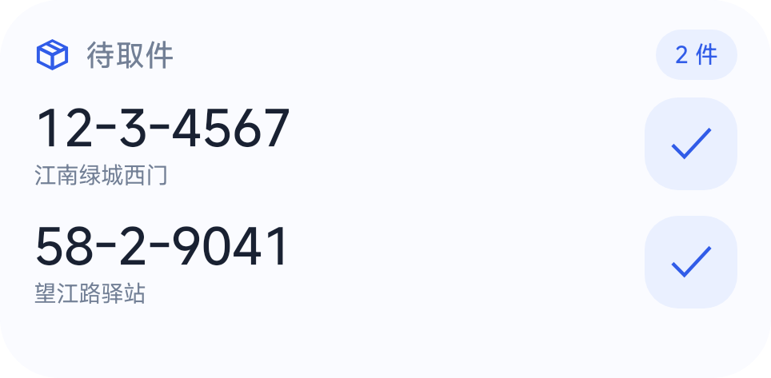
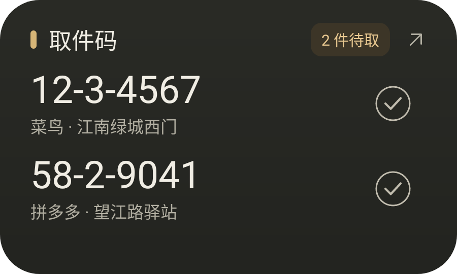

# 取件卡片、小米超级岛与背屏

## 采集与刷新时机

菜鸟、拼多多采集是 **App 数据加载事件触发**：Hook 数据回调，在 App 自己收到或解析物流数据后提取取件码，通过本机 Provider 保存。模块不定时轮询快递接口，也不会为了获取包裹主动联网。App 没启动、没刷新或没收到新数据时，模块没有新的包裹来源；打开菜鸟首页或拼多多物流助手可触发 App 自己加载数据。App 的网络请求间隔由 App 控制，模块没有固定读取频率。

代码中的 5 秒是提取开关的本机缓存有效期，30 秒是同来源、同取件码、同地点的重复回调去重窗口，均不是抓取周期。另有用户可设置的每日取件提醒，仅提醒已保存的待取件，不查询新物流。

拼多多混合列表只接受 `status_type=400`（待取件）且 `pick_code` 包含有效明文取件码的行；物流助手待取列表只接受明确的 `pick_code`；柜机详情只接受可显示明文码的待取状态。缺失、空值、占位、掩码、手机号提示及非字符串值会跳过，不从手机号、运单号或物流描述猜码。已在途、已取件等状态不会录入混合列表。这里过滤的是**模块保存的记录**。

## 桌面卡片

原生 RemoteViews 布局 `widget_pickup_v5`：大字号取件码、第二行地点、44dp 完成按钮，浅色与深色资源分别适配。卡片按高度显示完整数据行；长码按可用宽度缩小字号，不截断取件码。地点未知时显示来源。

点击码复制，点击完成按钮标记已取，点击卡片空白或标题查看全部。完成后行自然补位；不使用原生 RemoteViews 不支持的 alpha/translation 反射动画。关闭显示取件码后，整行隐藏，只保留件数汇总。

设置页使用相同的真实 RemoteViews 预览。预览数据仅在内存中生成，所有操作均禁用，不写入或修改本机包裹。

## 小米负一屏

`XiaomiPickupWidgetProvider` 单独声明小米 4×2 小部件，运行在 `:widgetProvider`，带有 `miuiWidget` 标识。应用声明 `miuiWidgetVersion`，支持小米刷新广播和 ID 恢复；普通桌面 Provider 保留。

“添加小组件 → 小米负一屏”按官方 `requestPinAppWidget` 扩展参数请求打开小米小部件详情页，由用户选择添加位置。**注册 Provider 不等于被小米小部件中心收录**：正式中心只展示审核通过的组件，未上架版本需要小米提供的测试环境。不会伪造上架状态，也不会修改负一屏数据库。

参考：[小米小部件技术规范](https://dev.mi.com/xiaomihyperos/documentation/detail?pId=1584)、[未发布组件与深色模式说明](https://dev.mi.com/xiaomihyperos/documentation/detail?pId=1591)。

## 小米超级岛

本地通知使用 `miui.focus.param` 的 `param_v2`，包含大岛、小岛、焦点卡片、图标与 PendingIntent 动作。按系统报告的 `notification_focus_protocol >= 2` 判断能力，不把 ROM 名称或 OS 版本号当开关：支持 OS2 焦点通知、OS3 超级岛，也不会排除 OS4 或后续协议版本。**协议版本号不等于 HyperOS 版本号**。未报告能力或协议不可读取时使用普通通知；平台不允许展示时也保留普通通知，不发送云推送、不上传包裹数据。

普通通知汇总当前待取包裹；完成或删除后仅更新仍然存在的提醒，全部完成时清除。用户划掉的通知不会因普通数据刷新重新出现。普通通知锁屏公开版与 AOD 文案仅包含件数，完整取件码位于私密通知内容。

**系统支持、焦点开关、平台鉴权是不同条件。** `canShowFocus=true` 不能证明小米平台鉴权成功。正式接入需要在小米开发者平台登记应用与签名、开通对应场景。构建时可传公开的应用 ID：

```sh
./gradlew :app:assembleRelease -PPICKUP_XIAOMI_APP_ID=你的应用ID
```

该参数进入 `com.xiaomi.xms.APP_ID`；调试版另带 `com.xiaomi.xms.BUILD_TYPE_DEBUG=true`，仍需平台配置对应调试签名/测试资格。不要填入 APP_SECRET、GitHub token 或其他密钥。

此前实机返回协议 3、焦点权限开启，系统日志显示模板渲染成功；最终鉴权返回 `-210`，错误为无法连接小米鉴权服务。这是连接失败，不能当作已证实的签名拒绝。尚未验证实际上岛。负一屏应用列表同样出现网络不可用，未验证成功添加；桌面卡片已验证显示。当前尚无 OS4 实机结果。

参考：[本地超级岛通知协议](https://dev.mi.com/xiaomihyperos/documentation/detail?pId=2131)、[平台接入与签名鉴权](https://dev.mi.com/xiaomihyperos/documentation/detail?pId=2132)、[HyperOS 4 官网](https://os.mi.com/)。

### 已使用 LSPosed / HyperCeiler 的设备

模块设置或简洁模式「更多选项」中的「超级岛与背屏」提供通知设置入口与以下说明。系统通知权限仍需开启，HyperCeiler 的两种解锁处理的是不同条件：

| HyperCeiler 入口 | 功能与作用域 |
| --- | --- |
| 系统界面 → 控制中心 → 移除焦点通知白名单；配置焦点通知列表 → 选择「取件码助手」 | SystemUI 展示白名单；作用于 `com.android.systemui` |
| 小米服务框架 → 解锁焦点通知白名单签名验证 | 小米鉴权结果；作用于 `com.xiaomi.xmsf` |

按 HyperCeiler 提示重启对应作用域。只放开 SystemUI 白名单不能证明鉴权已放行；只放开鉴权也不代表系统通知开关、背屏模板等条件已满足。上述入口与实现已对照源码，不同 HyperCeiler / ROM 版本可能有变化，OS4 的可用性仍取决于对应模块版本；本项目不自动安装、修改或启用其他模块。

源码依据（HyperCeiler `0830c5875570e66ae576b9276b0e57033cb6601a`）：[SystemUI 白名单 Hook](https://github.com/ReChronoRain/HyperCeiler/blob/0830c5875570e66ae576b9276b0e57033cb6601a/library/libhook/src/main/java/com/sevtinge/hyperceiler/libhook/rules/systemui/statusbar/island/UnlockFocus.kt)、[小米服务框架鉴权 Hook](https://github.com/ReChronoRain/HyperCeiler/blob/0830c5875570e66ae576b9276b0e57033cb6601a/library/libhook/src/main/java/com/sevtinge/hyperceiler/libhook/rules/xmsf/UnlockFoucsAuth.kt)。未复制这些 Hook 的代码。

## 小米 17 Pro / Pro Max 背屏

采用标准超级岛通知作为背屏入口。小米官方「方案提报说明」明确写明：**小折叠 / 背屏手机无需单独适配，由小米侧自行适配**。因此沿用同一份取件码、地点、件数和通知动作数据；标记已取会更新同一条通知，全部完成时清除。背屏是否展开、布局和显示时长由系统控制。背屏通知与桌面 / 负一屏的 AppWidget 是不同展示机制。

本地通知公开版和 AOD 文案只含件数；背屏锁定时的最终隐私处理取决于 ROM，不把这些字段当作已通过背屏实机隐私验证。当前没有 17 Pro / Pro Max 设备验证结果，不能宣称已完成背屏显示适配验收。

对已经解除上岛限制但仍无背屏显示的设备，还要检查背屏通知开关、背屏白名单与对应模板。开源 [REAREye](https://github.com/killerprojecte/REAREye) 的「允许焦点通知显示在背屏」作用于 `com.xiaomi.subscreencenter`；其说明和实现都指出，**放开白名单后仍需匹配的组件 / 模板**。不能仅添加 `miui.rear.param`、填写任意 business 就保证生成卡片。本项目沿用官方标准模板路径，不额外发送未经实机验证的私有背屏参数。

依据：[小米背屏自动适配说明](https://dev.mi.com/xiaomihyperos/documentation/detail?pId=2144)、[REAREye 功能与条件](https://github.com/killerprojecte/REAREye/blob/e554a382dabdb79994fa11a4482c072c9f968c82/README.md)、[背屏白名单与模板检查实现](https://github.com/killerprojecte/REAREye/blob/e554a382dabdb79994fa11a4482c072c9f968c82/app/src/main/java/hk/uwu/reareye/hook/scopes/subscreencenter/modules/rearwidget/RearWidgetHook.kt)。

## 验证与示例图

`ParcelSurfacesTest` 使用真实 RemoteViews 验证布局、最小尺寸、大字、长码、深色模式重建、预览隔离，以及通知动作、锁屏/AOD 内容、协议 2–5 的标准模板和普通通知回退。协议模拟测试不等于 OS4 / 背屏系统验收。`AppParcelDataTest` 验证拼多多各入口仅录入明确的有效取件码，包含手机号、空码、非字符串和描述干扰场景。既有 App 数据采集与开关交互测试继续回归。

调试版独有、不可被其他应用启动的 `SurfacePreviewActivity` 可导出真实 Android 示例卡片。此 Activity 不进入发布版，示例图不含真实包裹或设备标识：

```sh
adb shell su -c 'am start -n io.github.okaidev.pickupcode/.SurfacePreviewActivity --ez export_preview true'
# 等待界面完成绘制后：
adb exec-out run-as io.github.okaidev.pickupcode cat files/widget-preview.png > widget-preview.png
# 深色示例跟随系统深色模式；切换后用 --activity-clear-top 重建 Activity。
```

旧的 `tools/gen_widget_preview.java` 仅用于历史 v4 预览；当前选择器图片从上述真实布局导出。

浅色与深色示例（由 Android 真实布局导出）：




